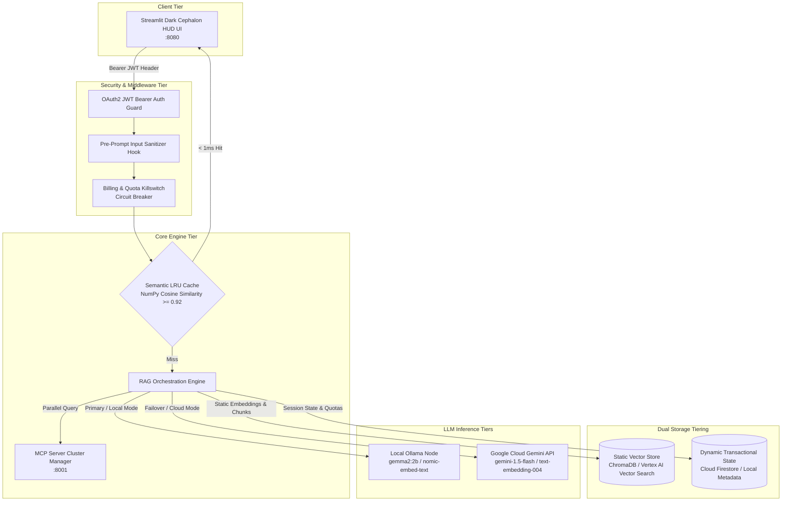

# ORDIS: Enterprise RAG Architecture & Warframe Combat Intelligence

[](https://www.python.org/)
[](https://fastapi.tiangolo.com/)
[](https://www.docker.com/)
[](https://www.trychroma.com/)
[](LICENSE)

ORDIS is an enterprise-grade microservice Retrieval-Augmented Generation (RAG) system built in Python. Designed as an interactive combat and lore assistant for the Warframe universe, ORDIS features a high-performance dark Cephalon HUD interface powered by FastAPI, Streamlit, ChromaDB / Vertex AI Vector Search, Model Context Protocol (MCP) servers, and hybrid LLM execution (Local Gemma 2B & Cloud Gemini 1.5 Flash).

---

## 🏗️ Enterprise System Architecture

ORDIS implements a decoupled microservice topology engineered for high availability, sub-millisecond response caching, zero-trust token authentication, and intelligent cost routing.



---

## 🌐 Dual Deployment Targets

ORDIS is architected to support two distinct operational deployment profiles:

### 1. **Profile A: Self-Hosted Autonomous Node (Default / Zero-Cost)**
* **Target Audience**: Self-hosters, private server deployments, offline/air-gapped operations.
* **Cost Profile**: **$0.00 / month** (Zero cloud API consumption).
* **Stack**: 100% containerized via `docker-compose`. Runs local Ollama (`gemma2:2b`), local embeddings (`nomic-embed-text`), local ChromaDB vector store, and JSONL telemetry.
* **Key Advantage**: Total data privacy, zero vendor lock-in, full infrastructure control.

### 2. **Profile B: Cloud-Native Enterprise Scale**
* **Target Audience**: Public multi-tenant SaaS hosting, serverless enterprise deployments.
* **Cost Profile**: Pay-per-use with active cost guardrails and billing killswitches.
* **Stack**: Deployed on GCP (Cloud Run / Firebase App Hosting), utilizing:
  - **Static Vector Tier**: Vertex AI Vector Search (or managed ChromaDB) storing static domain knowledge embeddings.
  - **Dynamic State Tier**: Cloud Firestore managing user sessions, dynamic daily quota buckets (`MAX_DAILY_QUERIES`), and telemetry event streams.
  - **Cloud LLM Engine**: Google Gemini 1.5 Flash (`gemini-1.5-flash`) via REST API with automatic circuit breaker fallback to local node.

---

## 🗄️ Storage Tiering Architecture

To maintain optimal cost efficiency and query performance, ORDIS strictly segregates static domain knowledge from dynamic state:

| Storage Tier | Technology | Purpose | Lifecycle / Operations |
| :--- | :--- | :--- | :--- |
| **Static Vector Tier** | ChromaDB / GCP Vertex AI Vector Search | Pre-computed embeddings of Warframe Codex, weapons, frames, and guides. | Immutable index; updated via background ingestion worker (`asyncio.to_thread`). |
| **Dynamic State Tier** | Cloud Firestore / Local JSONL & SQLite | Session states, OAuth token registries, daily query usage counters, telemetry logs. | Real-time transactional read/write; sub-10ms state synchronization. |
| **In-Memory Cache Tier** | NumPy LRU Semantic Cache | High-frequency query responses ($O(1)$ lookup speed). | Volatile; evicted via LRU policy at `MAX_CACHE_SIZE=1000`. |

---

## 🛡️ Cost Control & Billing Killswitch Architecture

To prevent cloud billing runaways during public hosting, ORDIS incorporates a multi-layered billing circuit breaker:

1. **Semantic LRU Caching**: Queries matching historical vectors with cosine similarity $\ge 0.92$ return in $<1\text{ms}$, skipping vector database queries and external LLM token generation.
2. **Quota & Rate Safeguards**:
   - **Prompt Length Cap**: Maximum 250 characters (`PROMPT_CHARACTER_LIMIT`) to prevent context-stuffing buffer attacks.
   - **Cooldown Cooldown**: 10-second request spacing (`COOLDOWN_SECONDS`) per user session.
   - **Daily Query Cap**: Maximum 300 queries (`MAX_DAILY_QUERIES`) per user per day.
3. **Automatic Cost Circuit Breaker (`billing_killswitch.py`)**: If Cloud Gemini API usage exceeds budget limits or HTTP rate limits (429/503), the engine automatically falls back to local Gemma inference without interrupting user chat streams.

---

## 📁 Repository Structure

```
ordis/
├── docker-compose.yml                  # Orchestrates local microservice stack
├── Dockerfile.backend                  # Container build for FastAPI backend (non-root)
├── Dockerfile.frontend                 # Container build for Streamlit frontend (non-root)
├── backend/
│   ├── main.py                         # FastAPI REST API & SSE streaming chat endpoints
│   ├── config.py                       # Centralized environment & setting management
│   ├── auth.py                         # OAuth2 password flow & Bearer JWT token verification
│   ├── billing_killswitch.py           # Cost routing, rate limits & circuit breaker engine
│   ├── rag_engine.py                   # Grounded RAG execution pipeline (Ollama + Gemini)
│   ├── vector_store.py                 # Abstract VectorStore interface (ChromaDB adapter)
│   ├── cache.py                        # NumPy Cosine Similarity Semantic LRU Cache
│   ├── hooks.py                        # Pre-prompt sanitization & post-response hooks
│   ├── telemetry.py                    # Multi-provider telemetry (Local JSONL & GCP)
│   ├── mcp_manager.py                  # Client manager for connected MCP servers
│   └── background_worker.py            # Non-blocking async background ingestion worker
├── mcp_servers/
│   ├── base.py                         # Standardized MCP server protocol contract
│   ├── wfcd_mcp.py                     # Warframe Community items feed MCP server
│   ├── wiki_mcp.py                     # Fandom Wiki guide pages MCP server
│   ├── market_mcp.py                   # warframe.market trade statistics MCP server
│   └── builds_mcp.py                   # Community gear & builds MCP server
├── frontend/
│   ├── app.py                          # Streamlit Cephalon HUD user interface
│   ├── assets/ordis_logo.png           # Cephalon core logo asset
│   └── .streamlit/config.toml          # Streamlit configuration & telemetry opt-out
└── tests/                              # Pytest automated test suite
    ├── test_auth.py
    ├── test_billing_killswitch.py
    ├── test_main.py
    ├── test_mcp_connectors.py
    ├── test_rag_engine.py
    ├── test_startup_health.py
    ├── test_telemetry.py
    └── test_vector_store.py
```

---

## 🚀 Quickstart Guide

### Option A: Local Autonomous Deployment (Docker Compose)

Launch the full stack locally with zero API key requirement:

```bash
# Clone the repository and navigate to root
cd ordis

# Build and start all microservice containers
docker-compose up --build -d

# Download local LLM models into Ollama container
docker exec ordis-ollama ollama pull gemma2:2b
docker exec ordis-ollama ollama pull nomic-embed-text
```

Access the services:
- **Cephalon HUD UI**: [http://localhost:8080](http://localhost:8080)
- **FastAPI REST API Docs**: [http://localhost:8000/docs](http://localhost:8000/docs)
- **MCP Servers Health**: [http://localhost:8001/mcp/health](http://localhost:8001/mcp/health)

### Option B: Cloud Hybrid Deployment (Gemini API Failover)

To connect ORDIS to cloud inference, copy `.env.example` to `.env` and configure your API key:

```bash
cp .env.example .env
```

Set inside `.env`:
```env
LLM_PROVIDER=auto
GEMINI_API_KEY=your_google_gemini_api_key_here
```

---

## 🧪 Automated Testing

Execute the unit and integration test suite:

```bash
PYTHONPATH=. .venv/bin/pytest tests/ -v
```

---

## ⚖️ License & Disclaimer

- **License**: Released under the [MIT License](LICENSE).
- **Disclaimer**: ORDIS is a fan-developed intelligence assistant for Warframe. Warframe and all associated assets and lore are intellectual property of Digital Extremes Ltd.

